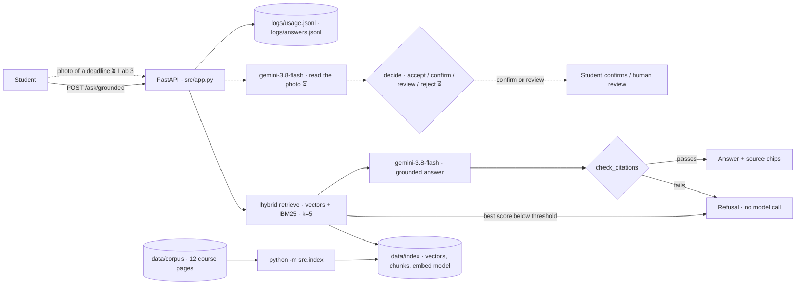

# Design Review · KIU CourseMate

Members: Nikoloz Tsikaridze · NTsik0 · repo keeper · Guram Tsiklauri · Gaaa-3 · spec keeper · eval keeper shared · Repo: https://github.com/NTsik0/TeamRepoAIPoweredApps · Graded commit: tag `design-review`

> **DRAFT 2026-10-14.** Sections marked ⏳ wait for the Lab 3 feature (image → deadline). Delete this line before tagging.

## 1 · Problem, users, success criteria

**Problem.** Course information at KIU is spread across a course README, a page per lab, a homework page per lab, milestone briefs and Teams posts, and the pages disagree as deadlines move: CS6920's own HW1 deadline is written two different ways across six of its pages. Students miss deadlines or ask the instructor the same question again.

**Users.** KIU students in CS6920 who want one fact fast ("when is HW1 due?", "who submits the Design Review form?"), usually from a phone. Secondary: the instructor, who answers fewer repeated questions. Full spec: [`docs/spec.md`](spec.md) · retrieval spec: [`docs/retrieval-spec.md`](retrieval-spec.md).

| # | Success criterion | Measured by | Today |
|---|---|---|---|
| S1 | Every answer cites the course page it came from, or refuses | golden set g1–g5, [`evals/results/2026-10-14-1942-live-k5.json`](../evals/results/2026-10-14-1942-live-k5.json) | **4/5 live (0.80)**, threshold 0.70 |
| S2 | No invented answer reaches a student: a citation to a source that was not retrieved is refused; off-topic questions are refused without a model call | [`tests/test_answer.py`](../tests/test_answer.py), 12 tests; golden g5 | passing; g5 refused live |
| S3 | Average cost per answer under $0.003 | [`evals/results/usage-2026-10-14-1942.json`](../evals/results/usage-2026-10-14-1942.json) | **$0.0016** ✅ |
| S4 | p95 latency under 3 s | same file | **14.1 s** ❌ (p50 4.7 s) · see risk R5 |

## 2 · Architecture and data flow

| Model call | Model id | Input | Output | Validated by |
|---|---|---|---|---|
| embed | `openai/text-embedding-3-small` | 111 chunks at ingest; the question at query time | unit-length vectors | index refuses a mismatched model ([`src/index.py`](../src/index.py)) |
| grounded answer | `google/gemini-3.8-flash` | prompt with 5 numbered sources | `{answer, citations, grounded}` | pydantic `Reply`, then `check_citations()` ([`src/answer.py`](../src/answer.py)) |
| ⏳ read a deadline photo | `google/gemini-3.8-flash` | downscaled image + schema | value, evidence, confidence per field | pydantic, then `decide()` (Lab 3) |

**Refusal before the model.** If no chunk scores above the threshold, the student gets the refusal and no model is called: nothing is generated from nothing. **Citation check.** The model numbers its sources; code checks every `[n]` against what was actually retrieved, and any mismatch is a refusal, never a warning. **Human in the loop** ⏳: a doubtful photo goes to the student to confirm, never straight into an answer.

## 3 · Risks and safety threats

| # | Risk | What a student would see | Mitigation | Owner |
|---|---|---|---|---|
| R1 | Outdated page wins: the corpus disagrees with itself (HW1: "Thursday of Week 4" vs "Tuesday 20 October") | the old deadline, stated as fact | prompt prefers the newest milestone page; golden g4 guards it (passes live); plan: a "last updated" field per document and newest-first ranking, Week 10 | Nikoloz |
| R2 | Invented answer with a real-looking citation | a made-up rule or date with `[1]` | `check_citations()` refuses unknown or inconsistent citations ([`tests/test_answer.py`](../tests/test_answer.py)); `must_mention` in the golden set | Guram |
| R3 | Confident answer to something the pages don't say (exam room, grades) | an invented room or grade | refusal path; golden g5 ("Which room is the midterm in?") refused live | Guram |
| R4 | Instructions hidden in a course page or a photo | the model follows them | prompt marks sources as data; corpus edited by humans only (AGENTS.md "Never"); red-team test planned Week 12 | Nikoloz |
| R5 | Slow answers (p95 14.1 s against a 3 s goal) | the student waits or gives up | measured, not yet fixed; plan: streaming (Week 6) and caching (Week 10); reasoning effort already `low` | Nikoloz |
| R6 | Personal data | a name or email exposed | instructor name and email removed from the corpus; no faces or names in test photos; the usage log never stores the question; the answer log does (it is needed to debug refusals), so `logs/` stays out of git (`.gitignore`) | Guram |
| R7 | ⏳ A blurry deadline photo read wrong | a wrong date accepted silently | Lab 3 confidence policy: low-evidence fields are never prefilled; confirm or review route | Nikoloz |

## 4 · Evaluation plan

- Golden set: [`evals/golden.yaml`](../evals/golden.yaml), 5 questions (2 factual, 1 reasoning, 1 edge, 1 refusal), threshold 0.70.
- Live runs on 2026-10-14: **k = 5: 4/5 (0.80)** [`…-live-k5.json`](../evals/results/2026-10-14-1942-live-k5.json) · k = 8: 3/5 (0.60) [`…-live-k8.json`](../evals/results/2026-10-14-1941-live-k8.json). Right sources were retrieved for all five questions at both settings. We kept k = 5 ([decision 0002](decisions/0002-choosing-k.md)).
- **What failed and why:** g2 ("How many watch-checks count toward the grade?") fails at both settings: `course/overview` was retrieved, but the model answered "not in the sources". The page says "best 8 of 10 count" in a sentence about the watch-check, not about the grade, so the question and the sentence share few words. Next step: read the retrieved chunk in `logs/answers.jsonl` and test a rephrased prompt; the question stays as it is.
- Offline runs (stand-in models, no key) are committed too; they measure retrieval only. 54 offline tests run in CI.
- **By Week 11:** 10 questions (3 factual, 2 reasoning, 2 edge, 2 refusal, 1 format), including one per Lab 3 photo route; the live run in CI on every pull request, blocking a merge below 0.70.

## 5 · Token budget

From our own usage log: 10 live answers, 22 model calls ([`evals/results/usage-2026-10-14-1942.json`](../evals/results/usage-2026-10-14-1942.json), produced by `python -m evals.usage_summary`).

| Feature | Model | Tokens in / out (average) | Cost per request | Latency | Source |
|---|---|---|---|---|---|
| grounded answer | gemini-3.8-flash + embedding | 1,777 / 68 | **$0.0016** | p50 4.7 s · p95 14.1 s | usage summary above |
| index the corpus | text-embedding-3-small | 111 chunks, once | under $0.001 | seconds | ingest run |
| ⏳ read a photo | gemini-3.8-flash | — | — | — | Lab 3 usage log |

**Monthly** at 300 students × 1 question a day × 30 days = 9,000 questions × $0.0016 ≈ **$14 a month**, about $28 when gemini-3.8-flash's 50% promotion ends.

**RAG or long context.** The 12 pages are about 78,000 characters ≈ 19,500 tokens. Sending all of them with every question: about $0.015 per question, **9.5 times** what retrieval costs, $136 a month at the same load, slower, and with the contradicting pages all in view at once. Retrieval wins.

## 6 · Team, roles and decisions

- Team contract: [`TEAM-CONTRACT.md`](../TEAM-CONTRACT.md) on `main`, both members signed · roles: [`docs/TEAM-REPO.md`](TEAM-REPO.md) section 1
- Decision records: [0001 keyword retrieval until Week 4](decisions/0001-keyword-retrieval-until-week-4.md) · [0002 choosing k (live: k = 5)](decisions/0002-choosing-k.md) · [0003 grounded answers on a new endpoint](decisions/0003-keep-keyword-ask-until-live-run.md)
- AI use is logged in [`docs/delegation-log.md`](delegation-log.md) (entries 1–2).
- Next: switch `POST /ask` to the grounded pipeline now that the live run passes (decision 0003); finish Lab 3 (Nikoloz drives, Guram reviews); Week 5 tools slice (Guram drives).
